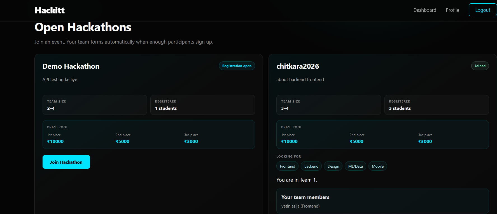
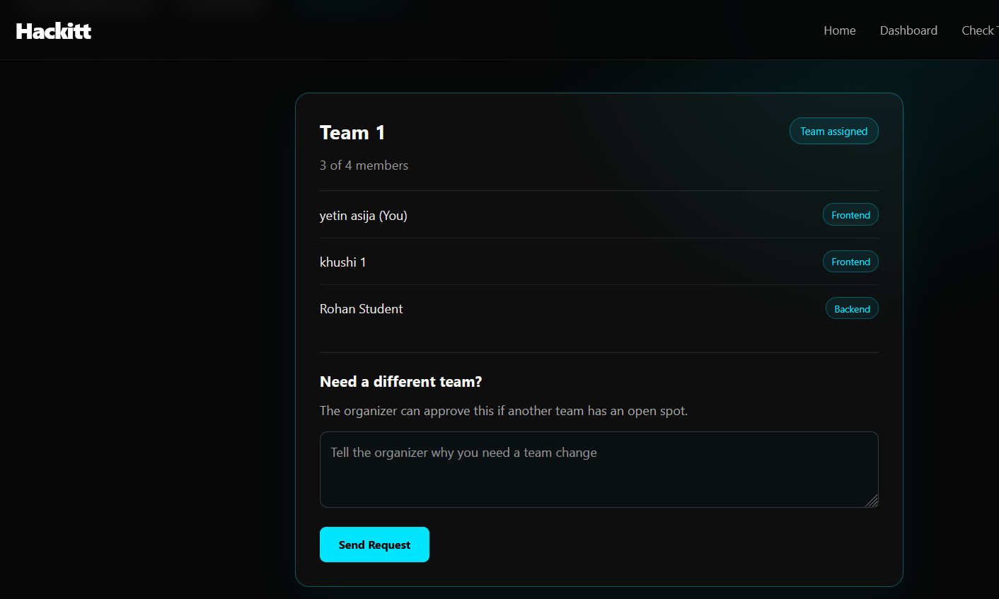
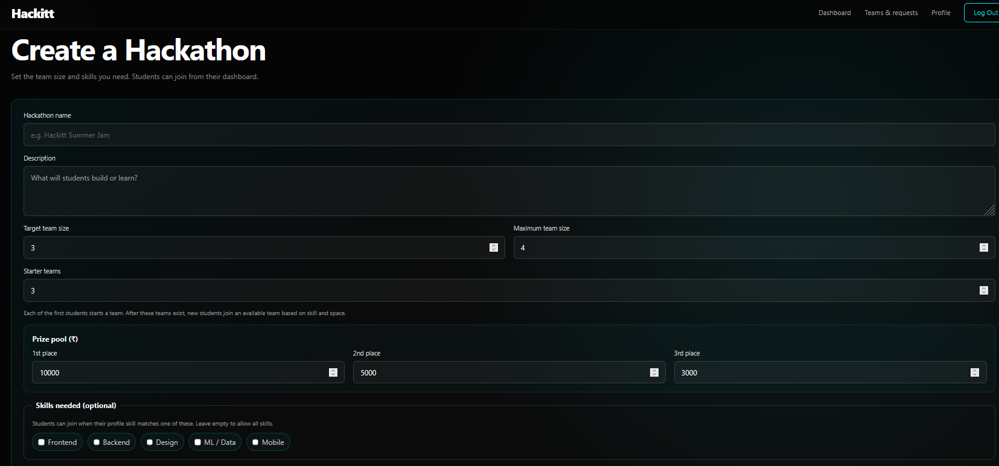
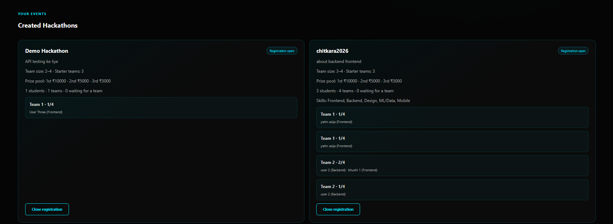
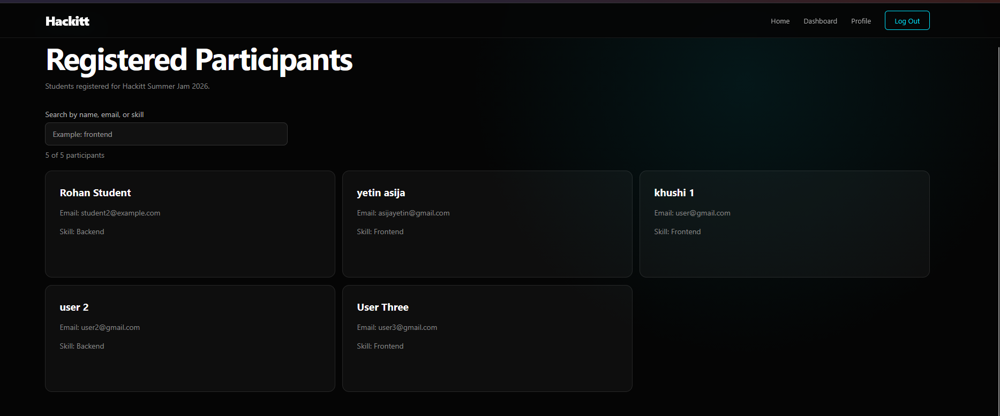
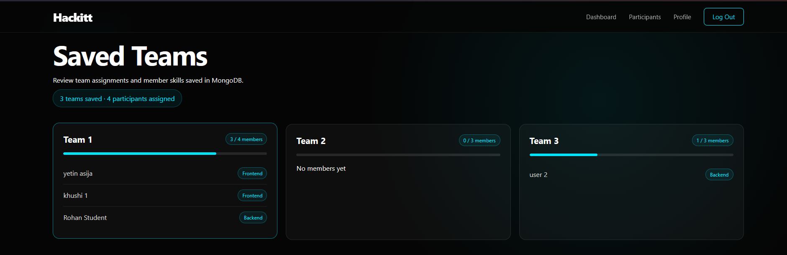

# Hackitt

Hackitt is a hackathon management platform for students and organizers. It provides role-based accounts, profiles, hackathon registration, participant management, team assignment, and team-change requests.

## Contents

- [Features](#features)
- [Application workflow and screenshots](#application-workflow)
- [Project structure](#project-structure)
- [Run the project locally](#run-the-project-locally)
- [API and authentication](#api-and-authentication)
- [Thunder Client testing](#thunder-client-testing)
- [MongoDB and Render deployment](#mongodb-and-render-deployment)

## Features

### Students

- Sign up and log in as a student.
- Create and update a profile, including skill information.
- Browse open hackathons and join eligible events.
- See assigned team and teammates.
- View hackathon history and results.
- Request a team change.

### Organizers

- Sign up and log in as an organizer.
- Create, view, update, and delete owned hackathons.
- View registered participants and teams.
- Generate and manage teams.
- Open or close hackathon registration.
- Review team-change requests and save hackathon results.

### Backend

- Express.js REST API with MongoDB/Mongoose persistence.
- JWT authentication and role-based authorization.
- Password hashing before storage.
- CRUD routes for profiles, participants, hackathons, teams, and team-change requests.
- MongoDB cleanup for related records when a participant, team, or hackathon is deleted.

## Application workflow

The application has two connected roles. Organizers set up hackathons and monitor participants; students register, join eligible hackathons, and see their assigned teams.

### 1. Sign up and log in

Create an account as either a student or organizer. A student chooses a skill during signup. After login, Hackitt opens the dashboard for that role.

**Signup page**

**Login page**

### Student workflow

#### 2. Open the student dashboard and profile

The student dashboard links to hackathons, the team page, and the profile. The profile stores the student's skills and shows participation information.

**Student dashboard**

**Student profile**

#### 3. Browse and join a hackathon

The student sees open hackathons and can join when registration is open and their skill meets the event requirements. The API prevents duplicate registration. After joining, it assigns the student to a team with space and shows the team on the student's page.

**Open and joined hackathons, with the assigned team shown**

#### 4. Check the assigned team

The student can open **View Team** to see only their own assigned team, its capacity, members, and member skills. The student does not choose or join a team from this page. If they need a different team, they can submit a change request with a reason; an organizer reviews it.

**Student Check Team page and team-change request form**

### Organizer workflow

#### 5. Open the organizer dashboard

The organizer dashboard provides access to hackathon management, participants, teams and requests, and the organizer profile.

#### 6. Create and manage a hackathon

The organizer enters the name and description, team-size limits, starter team count, prize amounts, and any required skills. The saved event appears in the organizer's event list. From there, the organizer can view participants and assigned teams, and open or close registration.

**Create a hackathon**

**Created hackathons, registration status, and team assignments**

#### 7. View registered participants

The participant page shows registered students, including their names, emails, and skills.

#### 8. Generate and review teams

The organizer can generate teams and review saved teams, member skills, and available capacity. For hackathon-specific teams, the organizer can also inspect the team assignments from the hackathon management page.

**View Teams (organizer)**

**Team generation**

#### 9. Review requests and finish the event

The organizer reviews team-change requests and can approve or reject them. When registration is closed, the organizer can select winning teams and save the event results. The hackathon is marked completed and its results are saved for the history pages.

## Project structure

~~~text
Hackitt/
├── Frontend/                 # HTML pages
├── assets/screenshots/       # Workflow screenshots used in this README
├── css/                      # Shared stylesheets
├── js/                       # Frontend logic and API client
├── backend/
│   ├── server.js             # Backend entry point
│   └── src/
│       ├── config/           # MongoDB connection
│       ├── controllers/      # Request handlers
│       ├── middleware/       # JWT and role checks
│       ├── models/           # Mongoose schemas
│       ├── routes/           # REST API routes
│       └── services/         # Team assignment and related logic
├── thunder-client/           # Thunder Client collection and environment
└── render.yaml               # Render Blueprint configuration
~~~

## Run the project locally

### Requirements

- Node.js LTS and npm
- A MongoDB Atlas database, or another reachable MongoDB instance
- VS Code with the Live Server extension for the frontend

### Configure and start the backend

1. Open a terminal in the project folder.
2. Create the backend environment file from the example:

   ~~~powershell
   Copy-Item backend/.env.example backend/.env
   ~~~

3. Edit backend/.env and set MONGO_URI to your MongoDB connection string and JWT_SECRET to a long private value. Keep this file private; it is ignored by Git.
4. Install dependencies and start the API:

   ~~~powershell
   cd backend
   npm install
   npm run dev
   ~~~

5. Check the API at http://localhost:5000/api/health. The response should say that the Hackitt API is working.

### Open the frontend

Open Frontend/index.html in VS Code and click Go Live. The frontend API address is configured in js/api.js. It currently points to the deployed Render API. To use a local backend instead, set API_URL in js/api.js to:

~~~text
http://localhost:5000/api
~~~

The frontend and backend run separately: Live Server serves the HTML/CSS/JS, while the Node.js server handles API requests.

## API and authentication

### Base URLs

- Deployed API: https://hackitt-api.onrender.com/api
- Local API: http://localhost:5000/api

All protected endpoints use the request header Authorization: Bearer <token>. In Thunder Client, set Auth to Bearer and paste the token. Use the organizer token for organizer-only requests and the student token for student-only requests.

### Signup and login

- POST /auth/signup — create an account. Send firstName, lastName, email, password, role, and optional skill. role must be student or organizer.
- POST /auth/login — send email and password. Copy the token from the response.
- GET /auth/profile — get the logged-in user's profile.
- PUT /auth/profile — update the logged-in user's profile.
- DELETE /auth/profile — delete the logged-in account and its associated student records. An organizer must delete their hackathons first.

Signup and login are public; the profile routes require that account's token.

### Hackathons

| Method | Endpoint | Access | Purpose |
| --- | --- | --- | --- |
| GET | /hackathons | Student or organizer token | List available/joined hackathons for a student, or the organizer's own hackathons |
| GET | /hackathons/:id | Student or owning organizer token | View one hackathon and team information |
| POST | /hackathons | Organizer token | Create a hackathon |
| PUT | /hackathons/:id | Owning organizer token | Update a hackathon before students join and while registration is open |
| PATCH | /hackathons/:id/status | Owning organizer token | Open or close registration |
| PATCH | /hackathons/:id/results | Owning organizer token | Save winners after closing registration |
| DELETE | /hackathons/:id | Owning organizer token | Delete the hackathon, its teams, and related team-change requests |
| POST | /hackathons/:id/join | Student token | Join an open, skill-eligible hackathon |

### Participants

| Method | Endpoint | Access | Purpose |
| --- | --- | --- | --- |
| GET | /participants | Organizer token | List registered students |
| GET | /participants/:id | Organizer token | View one participant |
| POST | /participants | Organizer token | Create a student participant |
| PUT | /participants/:id | Organizer token | Update participant details |
| DELETE | /participants/:id | Organizer token | Delete a participant and related participation data |

### Teams

| Method | Endpoint | Access | Purpose |
| --- | --- | --- | --- |
| GET | /teams | Public | List general teams not linked to a hackathon; not used by the current student View Team page |
| GET | /teams/:id | Public | View one team |
| GET | /teams/pending | Organizer token | List students waiting for a general team |
| POST | /teams | Organizer token | Create a team |
| POST | /teams/generate | Organizer token | Generate general teams |
| PUT | /teams/:id | Organizer token | Update a team |
| DELETE | /teams/:id | Organizer token | Delete a team |
| POST | /teams/:id/join | Student token | Backend endpoint for joining a general team; not part of the current student UI flow |

For teams belonging to a hackathon, use GET /hackathons/:id. The organizer sees all teams and members; a student sees their assigned team information.

### Team-change requests

| Method | Endpoint | Access | Purpose |
| --- | --- | --- | --- |
| POST | /team-change-requests | Student token | Submit a team-change request with a reason |
| GET | /team-change-requests/mine | Student token | View the logged-in student's request |
| GET | /team-change-requests | Organizer token | List all requests |
| GET | /team-change-requests/:id | Request owner or organizer token | View one request |
| PUT or PATCH | /team-change-requests/:id | Organizer token | Approve or reject a pending request |
| DELETE | /team-change-requests/:id | Request owner or organizer token | Delete a request; students can delete their own pending request |

### PUT and PATCH

- PUT is used for updating a record's editable details, such as a hackathon or participant.
- PATCH is used for a focused update, such as opening/closing hackathon registration, saving results, or approving/rejecting a team-change request.

Use a test record when demonstrating DELETE because the change is permanent.

## Thunder Client testing

The repository includes a ready-made Thunder Client collection and local environment:

- Collection: thunder-client/thunder-collection_Hackitt API.json
- Environment: thunder-client/thunder-environment_Hackitt Local.json

In VS Code, import both files into Thunder Client and select the Hackitt Local environment. Its baseUrl is http://localhost:5000/api. Start the local backend before sending requests. After signup/login, put the returned token in the matching organizerToken or studentToken environment variable. The collection includes requests for health, authentication, participants, hackathons, teams, and team-change requests.

To test the deployed API instead, change baseUrl to https://hackitt-api.onrender.com/api. Never save real JWT tokens or database credentials in a shared collection or commit them to Git.

## MongoDB and Render deployment

### MongoDB

The API uses MongoDB through Mongoose. Set MONGO_URI in backend/.env for local work. On Render, configure MONGO_URI as a private environment variable. Do not put database credentials in README, frontend files, or Thunder Client collection exports.

### Render

The root render.yaml configures the web service:

- Service name: hackitt-api
- Root directory: backend
- Build command: npm ci
- Start command: npm start
- Health check: /api/health
- Required environment variable: MONGO_URI
- JWT_SECRET is generated by Render

Create or update the Render Blueprint from the GitHub repository, set MONGO_URI in the service environment, and wait for deployment to finish. Confirm the deployment by requesting https://hackitt-api.onrender.com/api/health.

If a route returns 404 after a code change, confirm that Render deployed the latest GitHub commit and that the request URL uses the deployed service URL plus the correct /api route.

## License

No license file is currently included in this repository.

